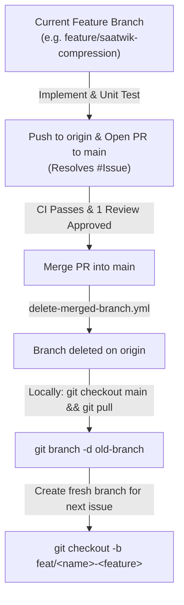

# Sprint 1 Execution Guide: Dependency Order & Branch Lifecycle

**Sprint Window:** 19th October 2026 – 23rd October 2026  
**Sprint Goal:** Deliver a working end-to-end compression & decompression product (`compress` → `decompress` produces 100% byte-identical restoration), passing automated GitHub Actions CI, and upload a **1-minute video demo** to the repository (`docs/media/sprint-1-demo.mp4`).  
**Project Board:** `Jackfruit Huffman Compressor` (View: `Sprint 1(19-23 Oct)`)

---

## 1. Sprint 1 Backlog: 13 Committed Issues (48 Story Points)

All 13 issues have been created and assigned on the project board:

| Issue | Title | Assignee | Story Points | Module / Layer |
|:---:|---|---|:---:|---|
| **#21** | `[UC-01] JACK-F-001: File input path reading, validation & permissions check` | Saatwik | 3 SP | `src/io/`, `src/compression/` |
| **#18** | `[UC-01] JACK-F-002: Byte frequency table construction & Huffman prefix tree builder` | Saatwik | 5 SP | `src/compression/` |
| **#19** | `[UC-01] JACK-F-003: BitWriter MSB-first bitstream packing engine` | Saatwik | 3 SP | `src/io/bit_writer.cpp` |
| **#20** | `[UC-01] JACK-F-004: Core Huffman encoder & .jack archive writer integration` | Saatwik | 5 SP | `src/compression/encoder.cpp` |
| **#23** | `[ARCHIVE] Implement ArchiveWriter for 18-byte header & metadata serialization` | Yuvraj | 5 SP | `src/archive/archive_writer.cpp` |
| **#24** | `[ARCHIVE] Implement ArchiveReader for header validation & metadata parsing` | Yuvraj | 3 SP | `src/archive/archive_reader.cpp` |
| **#25** | `[CI/CD] Automate PR builds & CTest test runner via GitHub Actions` | Yuvraj | 3 SP | `.github/workflows/ci.yml` |
| **#29** | `[UC-02] Parse & validate fixed archive header` | Tanmayi | 3 SP | `src/decompression/` |
| **#30** | `[UC-02] Reconstruct Huffman decoding tree from metadata` | Tanmayi | 5 SP | `src/decompression/` |
| **#31** | `[UC-02] BitReader sequential MSB-first bit extraction` | Tanmayi | 3 SP | `src/io/bit_reader.cpp` |
| **#32** | `[UC-02] Round-trip byte-identical file restoration` | Tanmayi | 5 SP | `src/decompression/decoder.cpp` |
| **#35** | `[SECURITY] Implement standalone IEEE 802.3 CRC-32 checksum engine` | Vibhav | 3 SP | `src/security/crc32.cpp` |
| **#36** | `[SECURITY] Support compressor pipeline with archive CRC-32 integration` | Vibhav | 2 SP | `src/security/`, Header CRC |

---

## 2. Who Should Start What: Execution Order & Critical Dependencies

### Phase 1: Parallel Independent Foundations (Days 1–2: 19–20 Oct)
*No one is blocked on Day 1! All four members can begin implementing immediately:*

1. **Yuvraj [CRITICAL PATH] — Start Issue #23 (`ArchiveWriter`) & Issue #25 (CI):**
   - **Action:** Build `ArchiveWriter` (`include/archive/archive_writer.hpp`, `src/archive/archive_writer.cpp`) implementing the 18-byte header (`0x4A41434B`, Version `0x01`, Big-Endian integers) and frequency table serialization.
   - **Why first:** Saatwik's encoder and Tanmayi's decoder both depend on the exact binary layout of `.jack` archives.
2. **Saatwik — Start Issue #18 (`FrequencyTable` & `HuffmanTree`) + Issue #21 (Input Validation):**
   - **Action:** Implement frequency counting array and min-heap priority queue to build canonical prefix codes (`src/compression/frequency_table.cpp`, `src/compression/huffman_tree.cpp`).
   - Zero external dependencies.
3. **Vibhav — Start Issue #35 (`CRC32` Calculation Engine):**
   - **Action:** Implement IEEE 802.3 CRC-32 lookup table generator and checksum computation (`include/security/crc32.hpp`, `src/security/crc32.cpp`).
   - Zero external dependencies; verify against test vectors (`"123456789"` → `0xCBF43926`).
4. **Tanmayi — Start Issue #31 (`BitReader`) & Issue #29 (Header Parsing):**
   - **Action:** Implement `BitReader` (`include/io/bit_reader.hpp`, `src/io/bit_reader.cpp`) reading bits MSB-first.
   - Tanmayi can unit test `BitReader` using synthetic hardcoded byte buffers before Saatwik's encoder is even finished!

---

### Phase 2: Bitstream Engines & Deserializers (Days 2–3: 20–21 Oct)
1. **Saatwik — Issue #19 (`BitWriter`):**
   - Accumulate bits MSB-first into a 1-byte buffer and flush to `std::ostream`.
2. **Yuvraj — Issue #24 (`ArchiveReader`):**
   - Implement reading and validation of header fields and deserialization of the symbol frequency table.
3. **Vibhav — Issue #36 (CRC-32 Archive Integration):**
   - Hand off CRC-32 checksum computation function to Saatwik & Yuvraj to embed into header bytes 14–17.
4. **Tanmayi — Issue #30 (Huffman Tree Reconstruction):**
   - Take the deserialized frequency map from `ArchiveReader` and reconstruct the identical Huffman decoding tree.

---

### Phase 3: Encoder / Decoder Pipeline Assembly (Days 3–4: 21–22 Oct)
1. **Saatwik — Issue #20 (`Encoder` Integration):**
   - Stream input bytes through `HuffmanTree` codes into `BitWriter` and write to `.jack` via `ArchiveWriter`.
2. **Tanmayi — Issue #32 (`Decoder` & Byte-Identical Restoration):**
   - Stream payload bits through reconstructed `HuffmanTree` leaf traversal and emit restored bytes to output file.

---

### Phase 4: Round-Trip Verification & 1-Minute Video Demo (Day 5: 23 Oct)
1. **End-to-End Validation:**
   ```bash
   ./build/bin/jackfruit compress sample.txt -o sample.jack
   ./build/bin/jackfruit decompress sample.jack -o restored.txt
   cmp sample.txt restored.txt  # MUST return 0 differences!
   ```
2. **Record 1-Minute Video Demo:**
   - Record terminal screencast showing: CMake build → CTest run → Compression execution → Decompression execution → `cmp` verification proving 100% byte identity.
   - Upload MP4 to `docs/media/sprint-1-demo.mp4`.

---

## 3. Git Workflow & Automated Branch Lifecycle

The repository has an automated workflow configured at `.github/workflows/delete-merged-branch.yml`. Whenever a Pull Request is merged into `main`, **GitHub Actions automatically deletes the source branch from `origin`**.

To prevent merge conflicts and stale branch issues, the team must follow this strict branch lifecycle:



### Step-by-Step Instructions for Team Members

#### For Your First Sprint 1 Feature:
1. You are already on your initial branch (`feature/saatwik-compression`, `feature/tanmayi-decompression`, `feature/yuvraj-statistics`, `feature/vibhav-integrity`).
2. Move your issue from **Backlog** to **In Progress** on GitHub Projects.
3. Write your code and GoogleTest unit tests.
4. Verify locally:
   ```bash
   cmake -B build -S .
   cmake --build build
   ctest --test-dir build --output-on-failure
   ```
5. Commit and push:
   ```bash
   git add <modified-files>
   git commit -m "feat(<module>): Implement <feature> (Resolves #<issue_id>)"
   git push origin <your-feature-branch>
   ```
6. Open a Pull Request targeting `main`.
   - Title: `feat(<module>): <Summary of work>`
   - Body: `Resolves #<issue_id>` (e.g., `Resolves #18`)
   - Request review from a teammate.
7. Once CI is green and 1 approval is granted, click **Merge pull request** (Squash and merge or Merge commit).
8. The GitHub Action will delete your feature branch on GitHub.

#### For Subsequent Features in Sprint 1 (CRITICAL RITUAL!):
Because your remote branch was deleted upon merge, **never push to that old branch again!** Follow these commands on your terminal:

```bash
# 1. Switch to local main and pull the latest merged code
git checkout main
git pull origin main

# 2. Delete your old local branch that was merged
git branch -d feature/<old-branch-name>

# 3. Create a fresh branch off the latest main for your next issue
git checkout -b feat/<your-name>-<next-feature-name>
# Example: git checkout -b feat/saatwik-bitwriter
# Example: git checkout -b feat/yuvraj-archive-reader
# Example: git checkout -b feat/tanmayi-decoder
# Example: git checkout -b feat/vibhav-crc-integration

# 4. Move your next issue to "In Progress" on the project board and start coding!
```

#### How to Stay in Sync with Teammates' Work:
Whenever another member merges code to `main` that you need:
```bash
git fetch origin
git merge origin/main
```
This keeps your active feature branch completely up to date with zero drift.
